  

<!-- CAPTION:START -->
The window shows the weather in Toronto right now (clouds, -4°C). The main monitor scrolls my latest commits, the second one is always training something, and the shelf holds a book for each language I write.
<!-- CAPTION:END -->

[LinkedIn](https://www.linkedin.com/in/taksh-girdhar-0a7552260/) · [Email](mailto:takshgirdhar@email.com) · [Website](https://asktaksh.notion.site/ds-portfolio-home)

| Project                                                                                                                    | Result                                                                                                                                                                                 | Stack                                   |
| -------------------------------------------------------------------------------------------------------------------------- | -------------------------------------------------------------------------------------------------------------------------------------------------------------------------------------- | --------------------------------------- |
| **Interpretability for AI Medical Scribes** Whisper ASR → LLM clinical notes · paper in progress        | Found that hallucination risk sits in the LLM step, not speech recognition: muting a claim's source audio changed only 40% of claims, and defaults like "no known allergies" persisted | PyTorch · Transformers · scikit-learn |
| [**Vicky: AI VC Agent**](https://github.com/Takshg/JUNE-Analytics-Vicky-Agent) 🥉 3rd place, Catalyst 2026 | Multi-agent coach that never invents a number; ~9× faster responses at $0 AI cost, 198-test suite                                                                                     | LangGraph · Gemini · SQLite           |
| [**Jersey Number Recognition**](https://github.com/Takshg/Jersey-Number-Recognition)                                  | Raised accuracy from 49.7% to 76.4% and made recognition 7.6× faster by fine-tuning a vision-language model                                                                           | Qwen3-VL · LoRA · OWLv2               |
| [**Rideshare Dynamic Pricing**](https://github.com/Takshg/Rideshare_Dynamic_Pricing)                                  | Explainable pricing API (R² 0.875); showed aggressive surge pricing would cut revenue 62%                                                                                             | FastAPI · Docker · SHAP               |
| [**Palm Club Employee Churn**](https://github.com/Takshg/palm-churn-eda) 🥈 2nd place, BOLT BootCamp 2026  | Traced ~80% high-performer turnover to a missing promotion process; built a manager dashboard                                                                                          | pandas · SQL                           |
| [**NYC 311 Service Efficiency**](https://github.com/Takshg/Operational-Efficiency-NYC-311)                            | Statistical study of 764K requests: high-load days run 2.5× slower to resolve                                                                                                         | Negative binomial · Monte Carlo        |

<b>More projects</b>

 

- [**Fashion Retail Profitability**](https://github.com/Takshg/Product-Category-Profitability-and-Trends-Analysis): top 20% of SKUs drive 43.8% of profit; markdown simulation and RFM segmentation · SQL, Python, Tableau
- [**Airbnb Price Estimation**](https://github.com/Takshg/Airbnb-Price-Estimation): Neyman sampling cut estimate variance 53% vs. simple random sampling
- [**Spotify Streaming Trends**](https://github.com/Takshg/Spotify-Streaming-Trends): K-Means hit profiles across 23K+ chart entries
- [**Programming Language Network**](https://github.com/Takshg/COSC421_Project): 12K job postings → 8 skill communities with Leiden clustering
- [**Heart Disease Prediction**](https://github.com/Takshg/Heart-Disease-Prediction): interpretable logistic regression beat XGBoost on ROC-AUC (0.95)

**Languages** Python · SQL · R · Java · JavaScript
**ML & AI** PyTorch · TensorFlow · Hugging Face · scikit-learn · LangGraph · Captum · SHAP
**Data & Stats** pandas · NumPy · SciPy · regression & GLMs · time series · experimental design
**Analytics** Tableau · Excel · Matplotlib · Seaborn · Plotly
**Engineering** Git · FastAPI · Docker · Kubernetes · PostgreSQL

🎓 Dean's Scholar, UBC (2025–26) · 🌍 UBC International Major Entrance Scholarship (2022–26) and Outstanding International Student Scholarship (2022)· 🥈 BOLT BootCamp 2026 · 🥉 Catalyst 2026
