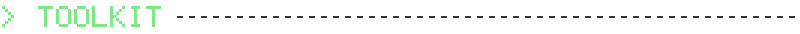

  

<!-- CAPTION:START -->
The window shows the weather in Toronto right now (clear skies, 10°C). The main monitor scrolls my latest commits, the second one is always training something, and the shelf holds a book for each language I write.
<!-- CAPTION:END -->

[LinkedIn](https://linkedin.com/in/your-handle) · [Email](mailto:you@email.com) · [Resume](https://link-to-resume.pdf) · [Website](https://your-site.com)

| Project | What it is | Stack |
|---|---|---|
| [**Whisper Interpretability in AI Scribes**](https://github.com/your-handle/repo) | Research paper probing how OpenAI's Whisper behaves inside AI medical-scribe pipelines | Python · PyTorch · Whisper |
| [**Breachpoint**](https://github.com/your-handle/breachpoint) | Built solo in 48 hrs for the IBM "Before the Breach" track at Sheridan Datathon 2026 | Python · pandas · scikit-learn |
| [**[Library name]**](https://github.com/your-handle/repo) | A from-scratch PyTorch library that removes a common pain point in deep-learning research *(in progress)* | Python · PyTorch |

**Languages** Python · SQL · R  
**Data & ML** pandas · NumPy · scikit-learn · PyTorch · Hugging Face  
**Analytics** Tableau / Power BI · Excel · Jupyter  
**Workflow** Git · Docker · Linux
